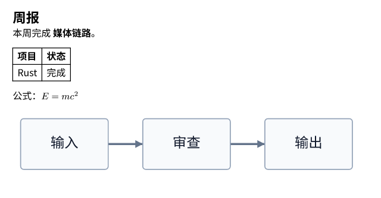

# V4 媒体与 Jev benchmark pilot · 2026-10-22

媒体的本地完整链路已验证：真实模型 → 结构化消息/原生工具 → 独立模型审查 → 实际文件 → OneBot 数组 outbox。Jev API 适配器和测试集已就绪，但没有账号凭据，**尚无 Jev 准确率、延迟或收益结论**。

## 已运行的证据

主模型和审查模型均请求 `deepseek-flash`，固定使用仓库的 `system-prompts.yaml`。md2svg 固定到 `91cf197ea5fb082dceeb09abc746712c9b670eca`，resvg 为 0.47.0。模型通过网络实际调用，Markdown 在本机独立进程中实际渲染；未连接 QQ。

16 个基础媒体用例各跑两种历史，共 32 组。长历史加入 8,000 个 Unicode 字符的固定无关内容，相关历史位于中间。两个变体不是独立样本。原始结果与数据库保留在本机忽略目录 `data/benchmarks/media-pilot-2026-10-22/`，公开的 [汇总 JSON](benchmark-results-2026-10-22.json) 包含数据集和 prompt 哈希。

| 维度 | 历史 | 首个输出符合结构/内容断言 | 最终完成且工具符合 | 整轮耗时中位数 |
| --- | --- | --- | --- | --- |
| 工作 | 简短 | 8/8 | 8/8 | 3.830 秒 |
| 工作 | 长干扰，中间放相关历史 | 8/8 | 8/8 | 4.592 秒 |
| 陪伴 | 简短 | 8/8 | 8/8 | 4.931 秒 |
| 陪伴 | 长干扰，中间放相关历史 | 8/8 | 8/8 | 4.661 秒 |

总计 42 次主模型调用、48 次隔离审查调用，累计整轮耗时约 182 秒。这里的整轮时间包含工具、审查、I/O 和所有输出，不是首 token 延迟。每组只有 8 例，不把样本 p95 当作生产尾延迟。

精确断言覆盖选第二张、行内图文顺序、三条独立消息、明确跨会话目标、原 GIF 复用以及不调用禁用工具。纯文字场景只自动检查目标、类型与工具，不自动评价共情或语义诚实。另抽看了私密图片拒绝、企鹅素材缺失、未知图片描述及情绪支持的实际原话：没有观察到替代图片或伪造媒体 ID。HTML 用例中模型直接说明不支持，没有发起无意义渲染；底层拒绝与恢复由实际 worker 测试另行验证。

周报用例的两个版本都提交了完整原文、宽度 640 和正确目标。中文、表格、公式、Mermaid 的实际输出经目视检查：

先前的 4 例冒烟中，曾出现一次审查响应未满足 provider `finish_reason` 要求；宿主拒绝该次动作，主模型纠正后完成。完整 32 组中没有拒绝动作。这说明审查服务自身的可用性和预算也必须计入端到端指标，不能只计行动模型耗时。

## 对架构的影响

1. 目前的证据支持保留两层数组和原生工具。图片选择、文字/表情/图片混排、分条与跨会话没有显示出需要增加业务工作流 DSL 或固定回复模型的理由。
2. 图片/GIF 复用应走真实引用；仅在用户需要精确排版时调用渲染。渲染工具只产出媒体，发送仍由 content 提议并单独审查。
3. 模型遵循与硬约束分别验证。私密素材在模型层被正确拒绝；离线另强制尝试越权、扩大已有授权和篡改文件，确认宿主独立拒绝。一次性 dry-run 不能取代 ID、受众、文件哈希和动作事实版本检查。
4. 渲染与主循环分开有实际收益：一次创建 Renderer 后，两次渲染使用同一 worker；不支持的输入后仍可恢复；硬超时会 kill + wait 并清理该次未完成产物。完整 pilot 的两次渲染也复用同一进程，结束后核对没有遗留 worker。
5. Jev 仍是有待验证的候选。计划固定 `jev-1.13.0`，按基础用例划分 calibration/test，对比相关历史位于前/中/后的结果，重点统计把真实任务压成模板/静默的错误。阈值先固定为所选概率 0.95、confidence 0.80，不根据 test 标签调参。

## 可复现性与边界

用例、定义和命令见 [benchmark v1](../benchmarks/v1/README.md)。本轮使用合成描述，不证明 Jev 或行动模型能识别原始图片；也不证明真实 QQ 的 GIF 保真、上传、收发和客户端行内显示。伴聊的自然程度仍需要人工评分及真实授权数据。

媒体登记和发送器已校验文件尺寸、类型、哈希与受众，worker 限制输入、队列、像素和输出并设硬超时；尚无操作系统级硬内存配额。入站下载、识别、文件生命周期和真实 NapCat 适配仍属于后续生产工作。

pilot 完成后补充了投影隔离：原始下载引用只保留在账本，提供给主模型、Jev 和审查器的资料移除 `source_ref`。该修改经过离线回归；上表的 live pilot 在它之前运行，所含引用仅为 `fixture://` 合成标识。没有把旧测量描述成修改后的重复实测。

当前离线回归为 22 项；真实 worker 测试另 1 项通过。主项目与独立 worker 均执行 Cargo 格式和 Clippy 检查。Jev 注册因本机 Chrome 窗口无法被工具激活而未开始，授权回复已收到，没有创建账号或生成 key。
