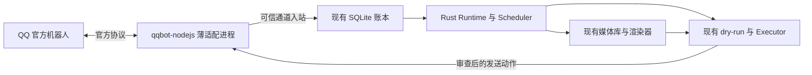

# dsh Super-agent、Grok Bot、GPT Dot 与 QQ 官方接入调研

调研日期：2026-11-02（Asia/Shanghai）。本地对照版本：`5b9ebf0`。本文记录调查与建议，不变更已经确认的 V4 契约，也不表示功能已实现。

## 结论

可以把 QQ 官方接入列为替代 NapCat 的主候选，前提是接受独立的官方机器人身份。建议复用腾讯的协议 SDK 做一个薄适配进程，继续使用 Rust Runtime、Ledger、媒体和 dry-run；不把完整 dsh Agent 循环引入主链路。

值得补的工程能力依次为：后台任务完成后唤醒、持久化内部投递、任务范围与订阅、版本化提示词、可追溯工作记忆。我们已有连续多来源事件、真实身份、消息段、独立审查与诚实回执，不需要因为新产品出现而重写这些边界。

证据分两类：dsh 与腾讯插件/SDK核对了公开源码；Grok Bot 与 Dot 核对了官方功能文档，未获得其内部调度、存储和模型实现，不能把产品行为当作源码事实。

## 公开版本

| 项目 | 本次检查版本 | 定位 |
| --- | --- | --- |
| [dsh-superagent-prototype](https://github.com/deepseek-ai/dsh-superagent-prototype/tree/6337fc823ce20251c8de8085948165c81aaa701e) | `6337fc8`，2026-10-31 | README 明确为研究原型；面向一个 GitHub 仓库，可接飞书，不等同于设计文章中的全部能力 |
| [dsh-qqbot](https://github.com/tencent-connect/dsh-qqbot/tree/a4a01fa9f122e187733fbd990c3d6a41e4d7e538) | `a4a01fa`，包版本 0.5.5 | 腾讯官方 dsh 插件，调用 ctx.agents 与 dsh 会话事件 |
| [qqbot-nodejs](https://github.com/tencent-connect/qqbot-nodejs/tree/429a0f1b798f3b0fcef3679e207dbc0469a1df2d) | `429a0f1`，1.0.5 | 独立协议 SDK；WebSocket/Webhook、鉴权、消息与媒体，不强制使用 dsh |

插件及 SDK 为 MIT。研究没有运行这些仓库中的安装脚本、启动机器人或发送 QQ 消息。

## 可参考的工程设计

### 1. 长工具变成有主人的后台任务

dsh worker 的前台 shell 等待很短，长命令进入后台；任务完成后携带真实结果唤醒 worker。轮次结束与后台工作结束分别判断，停止派工时回收其子任务。它还为人类继续已有任务保留额外执行容量。[执行说明](https://github.com/deepseek-ai/dsh-superagent-prototype/blob/6337fc823ce20251c8de8085948165c81aaa701e/docs/003-execution.md)、[后台任务源码](https://github.com/deepseek-ai/dsh-superagent-prototype/blob/6337fc823ce20251c8de8085948165c81aaa701e/src/executor/background.ts)。

本项目 `WebState::work` 只有一轮注意力在运行；HTTP仍能收消息，但 Runtime 要等工具返回才读取它们，bash/wait 可等待120秒。建议让长 bash 返回 job_id，由宿主持有进程、工作目录、结果和资源预算，完成后生成可信事件。原生工具回执首先诚实写为“任务已启动”，完成结果通过后续事件提供，不伪造第二个同 ID 工具结果。

主助手仍可直接完成短任务；复杂或长任务才分离执行上下文。无须把每条聊天固定送过一个 router 和一个 worker。人类改口应优先获得调度机会，但不会撤销已发生的副作用。

### 2. 将内部投递也落库，处理更新与执行之间的竞争

dsh 的 Effects 在业务事务中入库，提交后执行；队列行有稳定 key、顺序、generation、尝试次数和下次时间。旧尝试只能结算自己读取的 generation，避免把执行期间到达的新输入删掉。[Effects 源码](https://github.com/deepseek-ai/dsh-superagent-prototype/blob/6337fc823ce20251c8de8085948165c81aaa701e/src/app/effects.ts)。

V4 已有持久入站、检查点和动作生命周期；可补的是内部任务投递、完成唤醒和待发通知的同等级恢复。继续使用现有 SQLite，不为这个需求引入额外消息基础设施。

dsh Outbox 会重试发送；我们的未知效果约定应继续保留：持久队列不等于外部 exactly-once。已明确未开始的失败、可核实去重的请求和回执不明的发送必须分开，unknown 不自动重放。[Outbox 源码](https://github.com/deepseek-ai/dsh-superagent-prototype/blob/6337fc823ce20251c8de8085948165c81aaa701e/src/app/outbox.ts)。

### 3. 给后台工作保存范围与订阅，不按聊天窗口拆成不同人格

dsh 将任务授权范围与接收上下文分开；订阅可引入 CI、机器人和讨论，但不额外授予权限。任务处理过哪些输入、哪些还没真正读到都有记录；相关话题不自动成为同一任务。[领域模型](https://github.com/deepseek-ai/dsh-superagent-prototype/blob/6337fc823ce20251c8de8085948165c81aaa701e/docs/001-domain.md)、[授权与恢复](https://github.com/deepseek-ai/dsh-superagent-prototype/blob/6337fc823ce20251c8de8085948165c81aaa701e/docs/002-authorization.md)。

对我们可简化成任务记录：目标、来源事件、允许的能力/听众、订阅、执行实例和已读位置。模型决定怎样工作；宿主仅维持生命周期与边界。保留跨会话的连续主助手，不照搬“每个 QQ peer 一个独立 Agent”的插件默认行为。

### 4. 记忆、完整记录、当前上下文分开维护

Dot 文档区分当前选入上下文、长期笔记与对话历史；渠道共享连续性，但不把每个渠道的可见消息互相复制，也不因此增加披露权限。后台任务仅接收为其提供的材料。[Tasks and memory](https://learn.chatgpt.com/docs/dots/tasks-and-memory)。

我们的事件账本与来源标记已有基础；当前超出上下文预算仍会停止。下一步可以增加带证据引用和覆盖水位的工作笔记，保留原始事件，按任务检索。笔记不代替未读入站，不把模型推测升格成执行事实；无需先搭大型向量记忆系统。

### 5. 提示词覆盖保存 base 与 revision

dsh 保存不可变提示词版本、编辑所依据的默认文本和前驱版本；默认升级时展示变化，保留用户覆盖，版本冲突不会吞掉草稿。[提示词版本设计](https://github.com/deepseek-ai/dsh-superagent-prototype/blob/6337fc823ce20251c8de8085948165c81aaa701e/docs/004-prompts.md)。

这适合我们刚拆出的通用协议与 persona：未来提供编辑入口时，让协议、解析器及 schema 保持兼容，明确何时生效，记录每轮使用的版本。不要让人设覆盖通道身份或把重启服务当成日常编辑手段。

### 6. 区分接入来源、持续任务、通知与停止

Grok 把可复用方法与触发条件分开；Webhook 受理不等于任务完成，来源连接不等于已经创建监听任务。[Skills and routines](https://docs.x.ai/grok-bot/skills-routines-and-automations)。Dot 也明确区分暂停主任务、停止已委派工作和取消未来计划。[Controls](https://learn.chatgpt.com/docs/dots/controls)。

我们的 register_event 已能登记报告来源，但没有因此创建生产者或持续工作。未来提醒/监控应登记实际计划、来源、时区、通知目的地、权限依据及启停状态；不是让 wait 承担后台调度。WebUI 优先显示需要用户决定、失败待处理和可领取的结果。[dsh 面板设计](https://github.com/deepseek-ai/dsh-superagent-prototype/blob/6337fc823ce20251c8de8085948165c81aaa701e/docs/005-panel.md)。

## 哪些不直接照搬

- dsh worker 目录和命令包装器不是隔离边界；其文档明确提示可通过绝对路径绕过包装器。继续保留我们现有 workspace 隔离。
- Grok 的账号内多个 Bot 共用文件、浏览器登录和命令行凭据，各自屏幕不是安全隔离。可以参考资源复用，但不能从“有多个 Bot/窗口”推导隐私隔离。[Grok computer model](https://docs.x.ai/grok-bot/computer-and-apps)。
- Grok 的 Auto Review 与我们的单动作审查方向接近；新增价值主要是可见操作卡、明确审批人和不把密钥放进聊天，不是再套一个固定审查循环。[Approvals](https://docs.x.ai/grok-bot/approvals-security-and-privacy)。
- 官方 dsh 插件直接转发会话/流式回复，我们继续只发送完整解析、通过审查的消息提议，不把半截 JSON 或内部工具过程直接发进 QQ。

## QQ 官方接入：可以做，但不是个人账号协议替换

QQ 官方通道以 AppID/AppSecret 创建的机器人运行。扫码绑定插件不表示登录原个人 QQ；好友、会话身份与权限不会自然继承。若必须继续使用原个人账号和其现有好友关系，官方插件无法作为等价替代。[接入说明](https://bot.q.qq.com/wiki/develop/api-v2/)、[插件 README](https://github.com/tencent-connect/dsh-qqbot/blob/a4a01fa9f122e187733fbd990c3d6a41e4d7e538/README.md)。

| 能力 | 最新可证实情况 | 对本项目的含义 |
| --- | --- | --- |
| 私聊与群聊 | 官方均有事件和发送接口 | 不限于单用户命令入口 |
| 接收完整群聊 | 开启“接收所有消息”后有 GROUP_MESSAGE_CREATE | 不能沿用“官方只能接收 @”的旧结论；实际开关与目标群须验收 |
| Markdown | 官方说明单聊/群聊无需单独申请模板 | 可以翻译有序文字与图片；客户端排版仍需实测 |
| 图片/GIF | 接收附件有 image/gif；素材上传支持 png/jpeg/gif/webp | 有正式媒体链路；不能仅凭接受GIF格式就宣称动画完全保真 |
| 主动通知 | 有主动消息接口，受频控和用户接收开关约束 | 可以候选替代后台通知通道，不承诺无条件推送 |
| 用户身份 | C2C user_openid、群 member_openid/group_openid | 现有数字QQ号角色管理需增加官方通道身份；昵称不能绑定主人 |

依据：[群全量事件](https://bot.q.qq.com/wiki/develop/api-v2/autogen/event/group_message_create.html)、[Markdown](https://bot.q.qq.com/wiki/develop/api-v2/server-inter/message/type/markdown.html)、[消息规则](https://bot.q.qq.com/wiki/develop/api-v2/server-inter/message/overview.html)。

### 与我们媒体缓存直接相关的新能力

2026-10-21 新增的素材接口允许上传图片后返回 qqbot-media:// 引用，用于 Markdown。官方当前写明：单张10MB、每bot100张，90天未引用失效；引用与bot绑定。[素材管理](https://bot.q.qq.com/wiki/develop/api-v2/server-inter/message/material-management.html)。

因此本地原始媒体库与平台上传缓存必须分开：原图按现有哈希保存，平台只维护热素材；不要让100张平台配额限制我们的全部表情包库。普通富媒体 file_info 另有TTL，且单聊/群聊上传不互通；SDK已有按内容与目标范围缓存的机制，可以参考其接口。[SDK媒体说明](https://github.com/tencent-connect/qqbot-nodejs/blob/429a0f1b798f3b0fcef3679e207dbc0469a1df2d/USAGE.md)。

发送侧继续接受 messages/segments，适配器把同条图文转换为平台支持的 Markdown，独立图片走媒体消息。原生face、GIF动画、多图混排及入站位置还原需专门测；平台没有给出的片段位置不自行补造。md2svg继续服务精确排版，不要求所有文字先变图片。

### 文档和源码的已发现差异

- 官方Markdown页面已声明单聊/群聊开放；SDK USAGE 的旧限制段仍写需要特殊审核权限。应以最新平台文档和真实调用能力探测为准。
- 官方单聊接口页顶部写60分钟，但同页 msg_id 字段仍写5分钟；插件缓存则取30分钟。不能把其中任一旧常量当作已实测的平台保证。群聊5分钟及次数限制也需与主动降级一起测。[单聊接口](https://bot.q.qq.com/wiki/develop/api-v2/autogen/api/v2_users_user_openid_messages.post.html)、[插件回复缓存](https://github.com/tencent-connect/dsh-qqbot/blob/a4a01fa9f122e187733fbd990c3d6a41e4d7e538/src/transport/msgid-cache.ts)。
- 插件已有 nonce 与白名单点击者检查；这并不等同于“只允许这次请求的授权人批准”。如果增加审批卡，我们应绑定具体动作、审批人、参数版本与有效期，旧卡不能批准新动作。[审批实现](https://github.com/tencent-connect/dsh-qqbot/blob/a4a01fa9f122e187733fbd990c3d6a41e4d7e538/src/features/approval-channel.ts)。

## 建议的最小接入设计

以下为设计建议，未实现：

1. SDK 仅处理官方鉴权、连接恢复、原始收发和上传，使用回环/Unix socket 与 Rust 通信；不运行第二个模型、dsh SessionManager 或独立回复逻辑。以后若值得，再用 Rust 原生实现替换它。
2. 新增受信任的通道入站适配器；不要把人类 QQ 消息塞进 /hooks/events 冒充服务报告，更不要为了QQ而允许该报告接口自选 owner。原始入站先持久化，再做角色、去重和模型投影。
3. 身份显式包含 app_id、scope、conversation_openid、actor_openid。只有平台提供并核验的关联或用户在WebUI确认的绑定才跨渠道认人；不把OpenID硬塞进数字QQ号字段。
4. 将回调里的 auth_token、媒体下载签名等保存在受限传输资料中，模型和普通事件视图不接收这些密钥；必要媒体走现有受众检查和字节缓存。
5. 默认中间件不自动回复、不擅自改写媒体段。插件现成的 contentSanitizer/自动错误回复/typing/流式镜像不能不加选择搬过来绕过统一发送入口。[插件中间件](https://github.com/tencent-connect/dsh-qqbot/blob/a4a01fa9f122e187733fbd990c3d6a41e4d7e538/src/gateway/middleware-setup.ts)。
6. 回复机会、主动发送能力、媒体类型和限制作为目标能力提供；保存 msg_id/event_id、期限、msg_seq 与真实返回的 id。超时不能悄悄改目标，主动降级或拆条改变了实质动作时重新走提议/审查。
7. SDK支持跨进程保存Gateway session/lastSeq；但RESUME不是端到端无丢失证明，仍需入站幂等、已处理水位与故障验收。[SDK协议接口](https://github.com/tencent-connect/qqbot-nodejs/blob/429a0f1b798f3b0fcef3679e207dbc0469a1df2d/README.zh-CN.md)。
8. 切换前先并存两个适配器；只启用一个发送通道处理指定测试目标，防止一条入站从两条链路重复回复。通过真实验收后才停用NapCat。

## 下一步验收与优先顺序

首先做官方QQ单独的连通性切片，复用现有编排核验证：主人OpenID绑定、私聊、未@群消息、跨会话明确目标、原图/GIF收发、同条图文、媒体缓存复用、主动通知、重连重复入站、发送后断线回执不明、权限与额度拒绝。

通过标准是手机QQ上的真实结果和入账回执一致，不能用SDK返回成功或HTTP200代替客户端效果。这里只进行了文档与源码核对，没有官方Bot凭据和真实账号链路验收结果。

随后实现持久后台任务与完成事件，再做任务订阅和恢复；提示词版本/工作记忆按实际长会话问题推进。新增的是异步资源与状态管理，业务决定仍留给模型，不建立工作流DSL。
