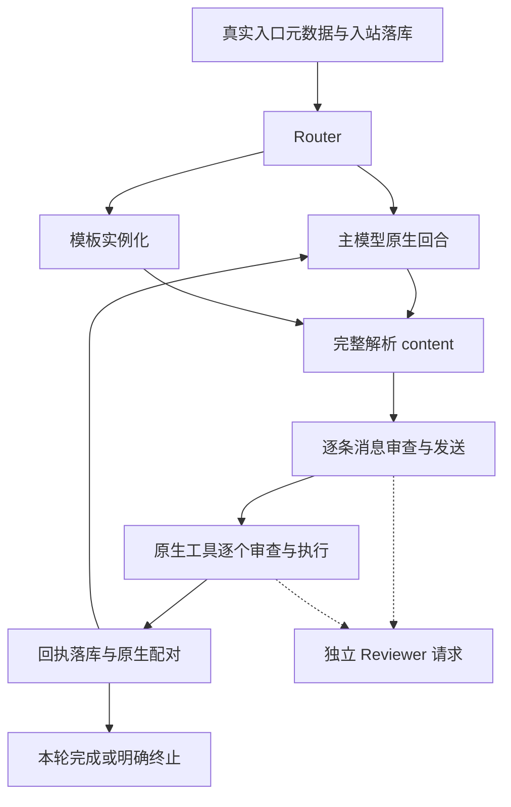

# V4 Rust 编排原型

这是按 [V4 契约](current-design.md) 拆分的可运行编排核：真实 OpenAI-compatible 模型、独立模型 dry-run、原生工具回合、结构化消息和 SQLite 事件恢复。默认输出到终端；启用媒体配置时将原生 OneBot 数组写入本地 outbox，每条回执明确标记 `local_onebot_outbox`。

它不是可部署的完整 QQ 服务。Jev System One 网络适配器已编写但尚未用真实凭据验证；md2svg/resvg worker 已完成本地实际渲染。真实 QQ 媒体下载、识别、发送、后台调度和上下文压缩尚未接入。

## 运行

从仓库根目录执行。构建使用 Cargo.lock；本机验证工具链为 Rust 1.95.0，项目声明最低 Rust 1.89。

```powershell
cargo test --locked --all-targets
cargo clippy --locked --all-targets -- -D warnings
cargo fmt --all -- --check

# 在当前 shell 中设置 MUTSUMI_API_KEY，再启动。
cargo run --locked -- --text "请查询现在时间"
cargo run --locked -- --session local-test --text "刚刚的工具回执是什么？"
```

配置位于 [config/v4.example.yaml](../config/v4.example.yaml)，示例使用 DeepSeek 的 OpenAI-compatible 接口及 `deepseek-flash`。接入其他提供商时修改 `base_url`、`model`、`api_key_env` 和预算。模型凭据只从指定环境变量读取，不写入 YAML、日志或数据库。DeepSeek 接口依据见 [官方 API 文档](https://api-docs.deepseek.com/)。

可以复制配置到被忽略的 `data/v4-prototype/config.yaml`，通过 `--config` 指定。所有路径以启动时的工作目录为基准。默认数据库为 `data/v4-prototype/events.sqlite3`，与 V3 数据分离。不要让两个进程同时使用该数据库；文件锁会拒绝第二个实例。

媒体模式使用 [v4-media.example.yaml](../config/v4-media.example.yaml)。先执行 `cargo build --locked --manifest-path workers/md2svg/Cargo.toml -j 2`，再执行 `cargo run --locked -- --config config/v4-media.example.yaml --text "把一段 Markdown 渲染成图片"`。worker 是独立 Cargo 包，要求 Rust 1.92；主程序保持 Rust 1.89。可选 Jev 的字段见 [jev.example.yaml](../config/jev.example.yaml)，复制到运行配置的 `jev:` 节点下；默认示例不启用 Jev。

`--session` 选择本地测试窗口，`--source` 必须来自目录，`--actor` 是受信任终端入口提供的身份元数据。它们用于模拟宿主适配器；用户正文无法修改这些字段。真实 QQ 接入时必须由平台来源确定身份和会话键，不能直接暴露这些参数给聊天正文。

## 模块与编辑入口

| 模块 | 职责 | 常见修改 |
| --- | --- | --- |
| [protocol.rs](../src/protocol.rs) | 消息段、目标目录、原生工具调用、动作指纹 | 增加平台消息类型时同步校验与 prompt |
| [runtime.rs](../src/runtime.rs) | 单个异步主循环，保留 provider 原生回合 | 修改每轮动作顺序、有限纠正、完成条件 |
| [provider.rs](../src/provider.rs) | `Model` 接口和 HTTPS 模型适配器 | 接入其他 API；保留非空 system 与工具配对 |
| [review.rs](../src/review.rs) | 一次性证据包、`Reviewer` 与模型审查 | 调整审查输入；推演不进入主上下文 |
| [executor.rs](../src/executor.rs) | 校验、审查、短事务门禁、执行与结果提交 | 增加执行器时保持真实回执与未知状态 |
| [ledger.rs](../src/ledger.rs) | append-first 事件、动作状态、恢复与上下文投影 | 数据演进需要版本迁移，不能删除原始事件 |
| [sender.rs](../src/sender.rs) | `Sender` 接口和终端发送器 | 实现 NapCat 适配器及送达语义 |
| [tools.rs](../src/tools.rs) | schema 唯一事实源、参数校验、时钟与可选媒体工具 | 增加真实工具并明确副作用 |
| [routing.rs](../src/routing.rs) | `Router` 接口、分类证据与模板实例化 | 接入 Jev，保持不确定时回到主模型 |
| [jev.rs](../src/jev.rs) | System One HTTP、choice 校验、阈值与模板路由 | 提示词在 `jev-prompts.yaml`，凭据仅从环境读取 |
| [media.rs](../src/media.rs) | 真实媒体登记、哈希、受众与检索 | 媒体来源决定可用受众，不能重复登记以扩大权限 |
| [onebot.rs](../src/onebot.rs) | 有序入站段、原生出站数组、本地 outbox | 后续接真实 NapCat 传输，不虚构送达 |
| [rendering.rs](../src/rendering.rs) | 有界队列、常驻 worker、超时回收 | 固定 worker 协议，模型不选择磁盘路径 |
| [app.rs](../src/app.rs) | 显式组装模型、门禁与适配器 | 保持主循环不依赖业务工作流 |
| [benchmark/](../src/benchmark/mod.rs) | 合成用例、素材、计时与评分 | gold 与模型输入隔离，原始结果留在忽略目录 |
| [config.rs](../src/config.rs) | 外部配置与预算验证 | 添加配置时同步示例与验证 |

提示词集中在 [system-prompts.yaml](../system-prompts.yaml) 的 `runtime`、`persona`、`reviewer`，改提示不需要改 Rust 正文。用户可编辑的预制回复在 [quick-replies.yaml](../quick-replies.yaml)。模板包含稳定 ID、类别、适用说明、启用状态、显式目标绑定和两层消息数组；不执行脚本。默认 `MainModelRouter` 全部交给生成模型；显式添加 `jev` 配置后才使用网络适配器，失败或低置信度回到主模型。尚未验证真实 Jev 准确率，也未实现热重载。



没有消息时跳过发送；没有工具时不添加工具或额外回复模型。动作执行顺序由本轮模型输出决定，主循环没有按“早安”“工作任务”等业务类别写工作流。

## 持久化和门禁边界

- 入站先落入 `events`；成功、失败、取消和中断均有记录。数据存储使用 WAL 与 `synchronous=FULL`，阻塞数据库操作通过 Tokio blocking pool 执行。
- `rounds` 保留去掉 `reasoning_content` 的原生提议供审计；`reviews` 独立存放一句审查结论。主上下文投影不接纳审查推演、未发送草稿或 `to_self`。真实成功消息、受众和回执进入可见历史。
- 每次动作的审查绑定确切参数指纹和事实版本。新入站或新动作结果会改变版本；执行前在短事务内重新检查并登记开始，事务外执行 I/O。原型采取全局保守失效策略；对象目录在进程内不可变。
- 内容结构错误时整轮不执行消息或工具，为原有 tool call 返回明确拒绝并有限纠正。目标缺失、对象未知或参数不合法时先确定性拒绝，不隐式补当前会话。
- 已开始动作等待适配器返回并提交结果，然后响应取消。发送器出错可能已产生部分效果，因此记作 `unknown`；不会自动重试本条或余下消息。进程中断的 `started` 动作也恢复为 `unknown`。
- 投影记录精确事件 ID，避免把未读取的新事件误记为已覆盖。未完成原生工具回合按持久化的真实 call 与动作结果恢复；未开始调用明确标记取消，不伪造成功。
- 默认注册无外部副作用的 `clock`。媒体模式另外提供 `media_search` 和 `render_markdown`；工具 schema 是能力事实源。媒体登记保存实际文件哈希、类型、尺寸与受众；发送前重验权限和字节。OneBot outbox 只证明原生数组已写入本地，不证明 QQ 接收或呈现。

审查器是模型语义判断，并不提供形式化安全保证。原型未实现生产调度器、同会话并发接入和外部事件 steering；目前是持有独占数据库的单入口 CLI。上下文超过预算时显式终止，不静默截断完整工具回合。

## 验证

[离线测试](../tests/orchestration.rs) 验证消息与工具顺序、隔离审查、目标门禁、消息段顺序、参数/事实失效、取消后落盘、部分发送、协议纠正上限、模型故障和重启恢复。

[真实模型测试](../tests/live_provider.rs) 默认忽略，需要主动提供 key 后执行，会产生少量 API 费用：

```powershell
cargo test --locked --test live_provider -- --ignored --nocapture
```

它只提交合成的问候、时钟查询、跨测试窗口发送与历史续接，发送器始终为终端。结果写入被忽略的 `data/v4-prototype/live-smoke-report.json`。该文件只有统计和合成测试标识，不含 key。本地实测结果见 [本轮验证记录](rust-prototype-validation-2026-10-18.md)。
